<div align="center">

# Wanggan Talking Head · 网感口播

[简体中文](README.md) · **English**

**MIT open source · Commercial use allowed · Preserve attribution and source** · [License](LICENSE) · [Attribution guide](COMMERCIAL.md#english)

### Turn what you say into visuals people can follow.

Give an agent your own talking-head footage. Let it design the art direction, layout, motion, camera and transitions around your words.

**19 base-style recipes · 8 storytelling modes · 11 design disciplines · 35 current full-video examples**

[See it in action](#see-it-in-action) · [Prompts to try](#prompts-to-try) · [Installation](#installation-and-setup) · [Styles and storytelling](#styles-and-storytelling) · [How it works](#how-it-works)

</div>

```text
Use the Wanggan Talking Head plugin to turn my uploaded footage into a complete video.
Choose a visual style and storytelling mode based on what I say.
Make objects, images and transitions work together to explain the content.
Keep my natural colors, use circular corner windows, raise the subtitles,
and preserve my original voice.
```

Choose a style such as Ink Wash, Photographic Minimalism or Technical Blueprint, or let the agent decide how the content should unfold. To revise an existing project, ask to change only the subtitles, adjust only the rhythm, or keep the style and use a different storytelling mode.

“Wanggan” is the project name. A video can be restrained, analytical, hand-drawn, print-inspired or spatial; its direction follows the content and your preferences.

## See it in action

**All 19 base styles and all 8 storytelling modes are shown below.** One Technical Blueprint branch and three agent-selected combinations are also included: **31 GIF previews** in total.

Every preview comes from an approved full video using **the same 36.7-second Chinese talking-head recording owned by the user**. Each GIF covers **13–21 seconds**, plays silently and loops for **8 seconds**. Compare how the same lines about unnecessary spending and distinguishing wants from needs are presented. The samples retain their Chinese captions; this English README does not dub or translate the videos.

[19 base styles](#19-base-styles) · [Technical Blueprint branch](#technical-blueprint-branch) · [Agent-selected combinations](#agent-selected-combinations) · [8 storytelling modes](#8-storytelling-modes)

### 19 base styles

Six browsing groups, all expanded. F01–F19 identify the existing style families; the titles use their approved recipe names. These groups help you browse and do not change the registry or count branches as additional base styles.

[Realism and graphic systems](#realism-and-graphic-systems) · [Collage and print](#collage-and-print) · [Lines and pixels](#lines-and-pixels) · [Illustration and painting](#illustration-and-painting) · [Chinese painting traditions](#chinese-painting-traditions) · [Space and handmade surfaces](#space-and-handmade-surfaces)

#### Realism and graphic systems

<table>
<tr>
<th width="33%">Photographic Minimalism<br><sub>F01 · minimal</sub></th>
<th width="33%">Modern Geometry<br><sub>F02 · geometry</sub></th>
<th width="33%">Precision Interface<br><sub>F07 · precision</sub></th>
</tr>
<tr>
<td align="center"></td>
<td align="center">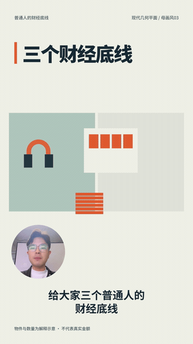</td>
<td align="center">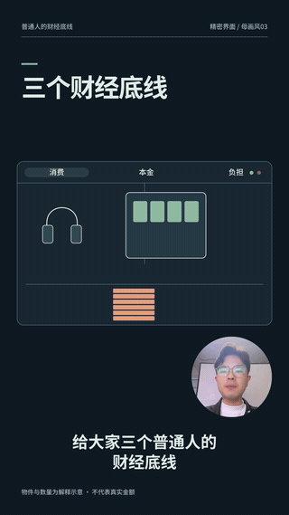</td>
</tr>
<tr>
<td>Keep the presenter prominent; use real objects, restrained labels and open space.</td>
<td>Use blocks, axes and clear figure-ground relationships to organize the explanation.</td>
<td>Arrange panels, annotations and status feedback as a clear inspection surface.</td>
</tr>
</table>

#### Collage and print

<table>
<tr>
<th width="33%">Editorial Collage & Print<br><sub>F03 · editorial-print</sub></th>
<th width="33%">Mixed-media Collage<br><sub>F04 · collage</sub></th>
<th width="33%">Retro Halftone<br><sub>F08 · halftone</sub></th>
</tr>
<tr>
<td align="center"></td>
<td align="center">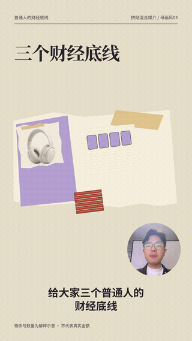</td>
<td align="center">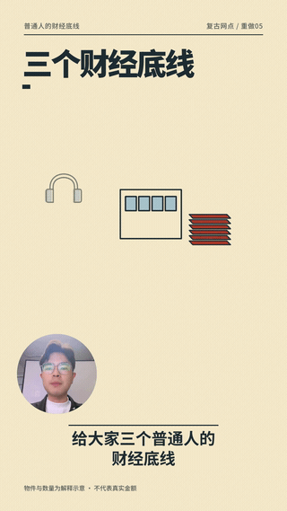</td>
</tr>
<tr>
<td>Paper pages carry images; serif headings, notes and strike-throughs make choices visible.</td>
<td>Combine contrasting image materials, cut edges and overlapping layers.</td>
<td>Use limited inks, halftone surfaces and divided comparisons for a printed look.</td>
</tr>
</table>

#### Lines and pixels

<table>
<tr>
<th width="33%">Single-line Drawing<br><sub>F05 · line</sub></th>
<th width="33%">Comic Line Art<br><sub>F09 · comic</sub></th>
<th width="33%">Retro Pixels<br><sub>F12 · pixel</sub></th>
</tr>
<tr>
<td align="center">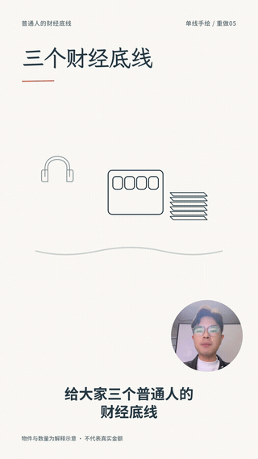</td>
<td align="center">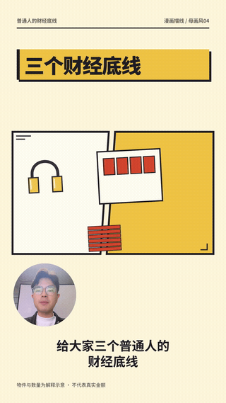</td>
<td align="center">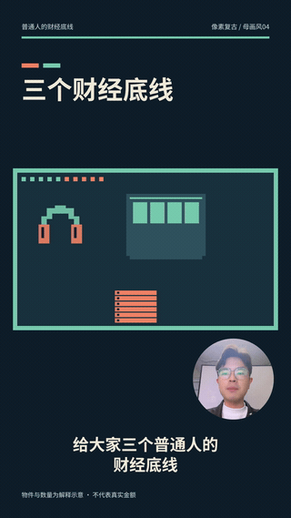</td>
</tr>
<tr>
<td>Draw, withdraw and reconnect lines while keeping the paper open and readable.</td>
<td>Use panels, outlines and reading order to move the explanation forward.</td>
<td>Use a discrete grid and limited colors for objects and changing states.</td>
</tr>
</table>

#### Illustration and painting

<table>
<tr>
<th width="33%">Flat Illustration<br><sub>F06 · illustration</sub></th>
<th width="33%">Watercolor Wash<br><sub>F17 · watercolor</sub></th>
<th width="33%">Impasto Oil Painting<br><sub>F18 · oil</sub></th>
</tr>
<tr>
<td align="center">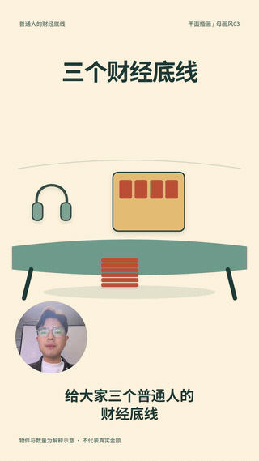</td>
<td align="center"></td>
<td align="center">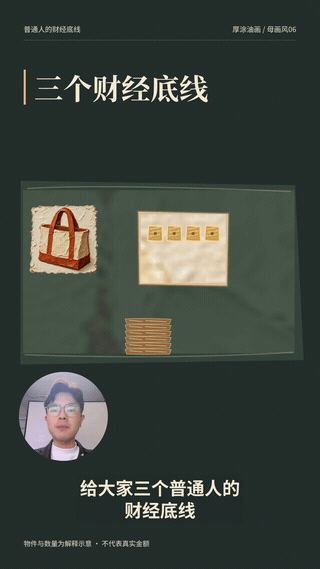</td>
</tr>
<tr>
<td>Build readable situations from recognizable objects and flat color shapes.</td>
<td>Use transparent washes, wet edges and paper white to create light layers.</td>
<td>Use brush marks, overlapping paint, volume and directional light.</td>
</tr>
</table>

#### Chinese painting traditions

<table>
<tr>
<th width="33%">Ink Wash<br><sub>F10 · ink</sub></th>
<th width="33%">Gongbi Painting<br><sub>F14 · gongbi</sub></th>
<th width="33%">Blue-green Landscape<br><sub>F15 · landscape</sub></th>
</tr>
<tr>
<td align="center">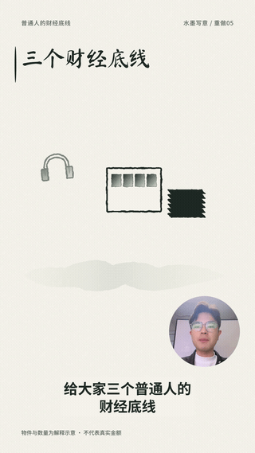</td>
<td align="center">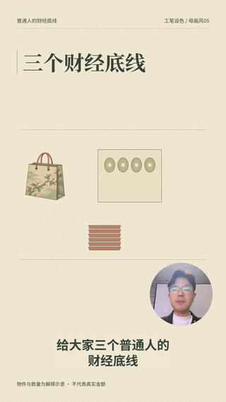</td>
<td align="center">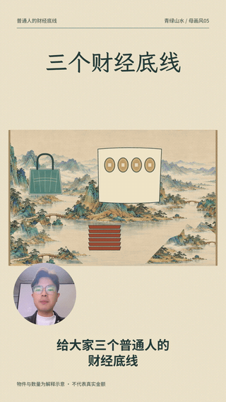</td>
</tr>
<tr>
<td>Use ink values, soft and firm edges, and open space to support object changes.</td>
<td>Fine outlines and layered pale colors keep shapes and details distinct.</td>
<td>Use layered scenery and mineral colors to establish a space for the eye to explore.</td>
</tr>
</table>

#### Space and handmade surfaces

<table>
<tr>
<th width="50%">Soft Clay 3D<br><sub>F11 · clay</sub></th>
<th width="50%">Paper-cut Stage<br><sub>F13 · papercut</sub></th>
</tr>
<tr>
<td align="center"></td>
<td align="center">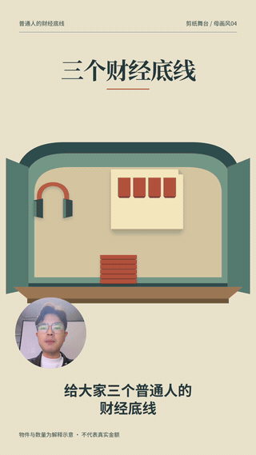</td>
</tr>
<tr>
<td>Volume, contact and shadows establish relationships between objects in space.</td>
<td>Visible layers, cutouts and thick edges create a stage made from paper.</td>
</tr>
</table>

<table>
<tr>
<th width="50%">Rich-color Mural<br><sub>F16 · mural</sub></th>
<th width="50%">Woodcut Print<br><sub>F19 · woodcut</sub></th>
</tr>
<tr>
<td align="center">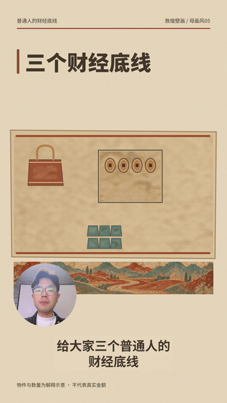</td>
<td align="center">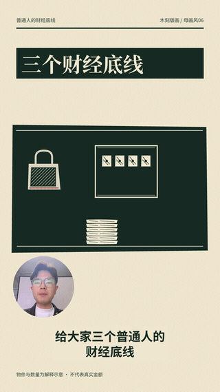</td>
</tr>
<tr>
<td>Color bands, wall texture and narrative zones organize the scene.</td>
<td>Positive and negative shapes, carved lines and print edges make relationships legible.</td>
</tr>
</table>

### Technical Blueprint branch

Technical Blueprint is **branch A09 of F07, the Precision Interface family**. Compare it with the default F07 recipe above.

<table>
<tr><th width="50%">Technical Blueprint · F07 / A09</th><th width="50%">What to look for</th></tr>
<tr>
<td align="center"></td>
<td>A deep blue field, line drawings, guides and sectional views connect objects across a shared engineering plane.<br><br>Try: Use the Technical Blueprint branch (<code>blueprint</code>) of Precision Interface. Design actions and continuous transitions around my narration.</td>
</tr>
</table>

### Agent-selected combinations

These three approved combinations change composition, object behavior and handoffs together. The presenter, voice and spoken content remain the same in the full videos.

<table>
<tr><th width="33%">Ink Wash × Object Relay</th><th width="33%">Precision Interface × Tracking & Focus</th><th width="33%">Soft Clay 3D × Action & Consequence</th></tr>
<tr>
<td></td>
<td></td>
<td></td>
</tr>
<tr><td>A seal and ink circles guide attention, carrying a previous judgment into the next section.</td><td>A stable work surface supports checking, excluding and locking onto what matters.</td><td>Falling objects, pressure, interception and unloading make consequences visible.</td></tr>
</table>

```text
Use my footage to create three clearly different combinations from the 19 base styles
and 8 storytelling modes. Start from the narration: define objects, actions and
visible outcomes, then design the images, camera and transitions.
Make three complete videos and put them on one local playback page for comparison.
```

### 8 storytelling modes

All eight use **Editorial Collage & Print (`editorial-print`)**, **the same Chinese recording**, and **the same 13–21-second excerpt**. Each preview lasts eight seconds and is silent. Compare information order, object behavior, camera movement, handoffs and presenter placement while the visual style stays consistent.

These are excerpts from full videos. The jump back to the start is the GIF loop, not a cut in the full edit.

[Objects and spatial continuity](#objects-and-spatial-continuity) · [Revealing and evaluating information](#revealing-and-evaluating-information) · [Actions and presenter responses](#actions-and-presenter-responses)

#### Objects and spatial continuity

<table>
<tr>
<th width="33%">Spatial Navigation<br><sub>G01 · spatial</sub></th>
<th width="33%">Object Relay<br><sub>G02 · relay</sub></th>
<th width="33%">Disassembly & Assembly<br><sub>G03 · assembly</sub></th>
</tr>
<tr>
<td align="center"></td>
<td align="center">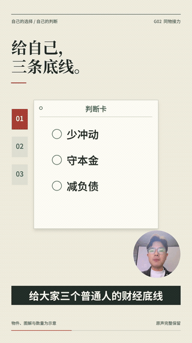</td>
<td align="center"></td>
</tr>
<tr>
<td>Move from the overview into the spending area while keeping its place in the larger map.</td>
<td>Move, unfold and hand off the same decision card, carrying a previous judgment forward.</td>
<td>Separate three suggestions into parts; open the current part while keeping the others accounted for.</td>
</tr>
</table>

#### Revealing and evaluating information

<table>
<tr>
<th width="33%">Parallel Comparison<br><sub>G04 · parallel</sub></th>
<th width="33%">Layered Reveal<br><sub>G05 · reveal</sub></th>
<th width="33%">Tracking & Focus<br><sub>G07 · tracking</sub></th>
</tr>
<tr>
<td align="center"></td>
<td align="center">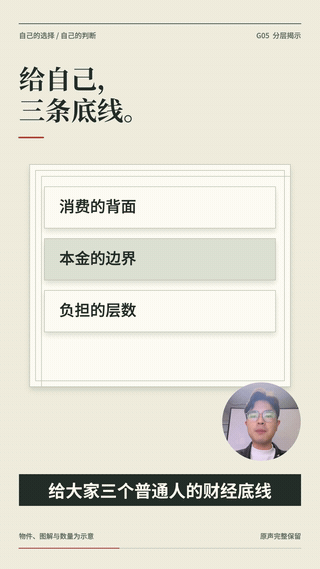</td>
<td align="center">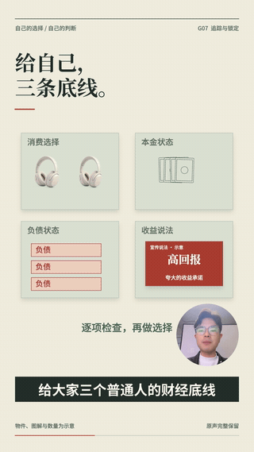</td>
</tr>
<tr>
<td>Keep both sides at a common scale so differences between choices remain visible together.</td>
<td>Start with the surface, then reveal the next layer when the narration calls for it.</td>
<td>Move an inspection frame from the search area to the evidence, then retain the selection or rejection.</td>
</tr>
</table>

#### Actions and presenter responses

<table>
<tr>
<th width="50%">Action & Consequence<br><sub>G06 · consequence</sub></th>
<th width="50%">Presenter Response<br><sub>G08 · response</sub></th>
</tr>
<tr>
<td align="center">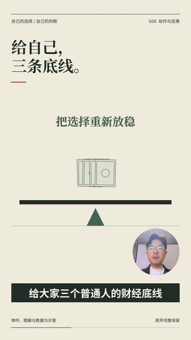</td>
<td align="center"></td>
</tr>
<tr>
<td>Crossing out an extra purchase frees space; the effect of the action remains visible.</td>
<td>Keep the presenter in the lead while keywords, objects and annotations respond to the spoken emphasis.</td>
</tr>
</table>

```text
Use Wanggan Talking Head. Keep Editorial Collage & Print (editorial-print)
and use Layered Reveal (reveal). Decide what to show first and when to uncover
new information based on my narration. Preserve my natural colors, circular
corner windows, raised subtitles and original voice. Produce a complete video.
```

The local gallery contains **19 base-style videos, 1 Technical Blueprint branch, 8 storytelling modes, 2 presenter/diagram treatments, 3 agent-selected combinations, and 2 single-module revisions**. It supports filtering, search, inline playback, muted simultaneous playback and one audible voice track. [Local gallery instructions (Chinese)](docs/全部案例总览.md)

This repository contains lightweight previews. Full MP4s and original footage stay in local projects; a new machine needs local video files bound to the gallery to play the full examples.

## What you can make

| What you need | How the agent approaches it |
|---|---|
| A complete talking-head video | Understand the original sentences, then coordinate the presenter, images, diagrams, actions and transitions |
| A specific visual style | Apply its recipe across color, materials, typography, camera and motion |
| An agent-selected direction | Choose a base style and primary storytelling mode from the content, explain the choice, then produce the video |
| Several versions to compare | Make layout, actions, camera and transitions clearly different, with playback on one page |
| The same style with a different narrative structure | Use Object Relay, Parallel Comparison, Layered Reveal or another mode, redesigning the handoffs |
| A change to one module | Save a new version, preserve unselected decisions and check necessary dependencies |
| A new direction later | Develop a recipe, style frames and a full test video; add it to the appropriate category after approval |

## Prompts to try

Upload your own footage or provide its accessible local path. **`talking-head-video` is the entry point for full production; you do not need to invoke all eleven disciplines separately.** Recipe and mode IDs below match the plugin registry.

### Choose a visual style

```text
Use Wanggan Talking Head to turn my uploaded footage into a complete video.
Use Editorial Collage & Print (editorial-print). Make paper pages, annotations
and images explain the narration together. Keep my natural colors, circular
corner windows, raised subtitles and original voice. Provide local playback.
```

### Let the agent choose

```text
Use Wanggan Talking Head. Choose a base style and storytelling mode based on
my topic, delivery and information structure. Briefly explain the choice,
then produce the video. Every key action should connect to a spoken idea
and leave a visible result; adjacent sections should connect naturally.
Use my own footage and voice, natural presenter colors, circular corner windows
and raised subtitles.
```

### Choose both style and storytelling mode

```text
Use the Technical Blueprint branch (blueprint) of Precision Interface,
combined with Layered Reveal (reveal). Decide what the audience sees first,
what is uncovered next, and which new information appears at each turn
in the narration. Preserve my natural colors, circular corner windows,
raised subtitles and original voice. Produce a complete video.
```

### Change only one module

```text
In the current project, change only typography and layout: stronger headings,
clearer diagram labels, and no text occlusion. Preserve the style, actions,
camera, transitions and voice. Save a new version for playback comparison.
```

```text
Change only the visual rhythm. Hold comparison results longer and reduce
simultaneous actions. Preserve the original speaking speed, duration,
content and storytelling structure. Provide a before-and-after comparison.
```

When revising in a new conversation, provide the **editable project path**. An exported MP4 alone does not preserve module-level editing information; the agent first needs to establish what can be changed. More examples for color, object motion, camera and transitions are in the [usage guide (Chinese)](docs/常用指令与使用指南.md).

## Installation and setup

The repository is **public**: no GitHub sign-in is needed to read either README, see the previews or access the source. The current setup has been tested locally with **Codex on macOS**. Other hosts and operating systems need adaptation and verification.

### If the plugin is already installed

Provide your footage and use one of the prompts above. To see the full examples, say:

```text
Open the Wanggan Talking Head recipe selector and full-video gallery.
Start the local preview service if it is not running.
```

### In a new environment

Give the agent this instruction:

```text
Get Wanggan Talking Head from https://github.com/maomyu/wanggan-talking-head.
Read README.en.md and AGENTS.md, check how plugins are installed in this host,
set up the repository's runtime dependencies and run doctor.
Then explain how I can supply my own footage and start a video project.
```

<details>
<summary>Manual checkout and environment checks</summary>

You need Node.js (`^22.15.0 || >=23.5.0`), Python 3.11+, FFmpeg and FFprobe. Locked dependencies are listed in [runtime/package.json](runtime/package.json) and [requirements.txt](runtime/requirements.txt).

```sh
git clone https://github.com/maomyu/wanggan-talking-head.git
cd wanggan-talking-head
node scripts/studio.mjs setup
node scripts/studio.mjs doctor
```

`setup` installs the pinned runtime under this repository's `runtime` directory. It does not register the Codex plugin or install missing system tools. Register the plugin using the host's installation flow. Keep the repository structure intact: the skills reference shared rules, recipes and runtime files.

On an environment that already has the local `personal` plugin marketplace configured:

```sh
codex plugin add wanggan-talking-head@personal --json
```

This command depends on that existing local marketplace configuration. It is not a one-command installation from a public marketplace.

</details>

## Styles and storytelling

**The base style defines the visual language; the storytelling mode defines how the audience follows the explanation.** Branches refine a style, while components supply reusable forms or behaviors. These are managed separately.

For example, choose Precision Interface, its Technical Blueprint branch, and Layered Reveal. Switching to Parallel Comparison also changes how comparison objects, actions and handoffs must be designed.

<details>
<summary><b>All 19 base-style recipe IDs</b></summary>

| Recipe | ID | Visual language |
|---|---|---|
| Photographic Minimalism | `minimal` | Presenter, real objects, open space and clear comparisons |
| Modern Geometry | `geometry` | Blocks, axes and figure-ground relationships |
| Editorial Collage & Print | `editorial-print` | Columns, crops, paper pages and annotations |
| Mixed-media Collage | `collage` | Contrasting images, seams and overlapping layers |
| Single-line Drawing | `line` | Drawn lines, paper white and connected relationships |
| Flat Illustration | `illustration` | Recognizable objects, flat color and readable situations |
| Precision Interface | `precision` | Functional panels, annotations and status feedback |
| Retro Halftone | `halftone` | Limited inks, halftone texture and divided comparisons |
| Comic Line Art | `comic` | Panels, outlines and reading order |
| Ink Wash | `ink` | Ink values, soft and firm edges, and open space |
| Soft Clay 3D | `clay` | Volume, contact, shadows and spatial relationships |
| Retro Pixels | `pixel` | Discrete grids and a restricted display vocabulary |
| Paper-cut Stage | `papercut` | Layers, cutouts, thick edges and a paper stage |
| Gongbi Painting | `gongbi` | Fine outlines and layered pale colors |
| Blue-green Landscape | `landscape` | Layered scenery, mineral colors and a traversable visual space |
| Rich-color Mural | `mural` | Color bands, wall surfaces and narrative zones |
| Watercolor Wash | `watercolor` | Transparent washes, wet edges and paper white |
| Impasto Oil Painting | `oil` | Brush marks, overlapping paint, volume and directional light |
| Woodcut Print | `woodcut` | Positive and negative shapes, carved lines and print edges |

Technical Blueprint (`blueprint`) is a branch of Precision Interface. See the [full recipe and entry-point guide (Chinese)](docs/19套配方与统一入口.md). The historical 100-item catalog has been reorganized into base styles, branches and components. Its useful assets and implementations remain available without duplicating the everyday choices.

</details>

### What each storytelling mode does

| Mode | Best suited to | How the picture develops |
|---|---|---|
| Spatial Navigation · `spatial` | Whole-to-part explanations, locations or steps | Move through one map, enter a detail, then return to the whole |
| Object Relay · `relay` | An object that continues across sections | Hand off its role while retaining its identity and earlier changes |
| Disassembly & Assembly · `assembly` | Parts and their relationship to a whole | Separate the parts, explain them, then show their combined relationship |
| Parallel Comparison · `parallel` | Two choices or before-and-after differences | Keep a shared scale so differences can be read side by side |
| Layered Reveal · `reveal` | Surface appearances, conditions and turning points | Uncover information in narration order, allowing time to understand |
| Action & Consequence · `consequence` | Causality supported by the actual words | A condition triggers an action whose result remains visible |
| Tracking & Focus · `tracking` | Inspection, filtering and judgment | Move from an area to evidence, then select or exclude a target |
| Presenter Response · `response` | Opinions, experiences and emotion | The presenter leads; images, text and annotations respond |

Presenter-led and continuous-diagram treatments remain available as compatible attention structures. The agent chooses a primary storytelling mode and uses supporting techniques only where the content needs them. [Full mode guidelines (Chinese)](docs/八类编排机制.md)

## How it works

### Find the actions in the words

For “distinguish wants from needs,” an extra purchase can be filtered out while a daily necessity remains. For “reduce the burden,” removing objects can let a loaded platform rise. Each action should make the spoken idea's change visible.

For each section, establish:

```text
Original words and relationship → Object's initial state → Action → Visible result
→ Time to understand → What carries into the next section
```

Images have specific jobs: identify objects, provide evidence or spatial context, or show a changing state. What survives one section becomes material for the next. New footage requires reading the new words and redesigning objects and handoffs. [New-footage workflow (Chinese)](docs/新素材制作流程.md)

### Eleven disciplines share one timeline

| Skill | Responsibility |
|---|---|
| [Base art style](skills/talking-head-art-style/SKILL.md) | Overall visual language and its boundaries |
| [Color palette](skills/talking-head-palette/SKILL.md) | Color roles for backgrounds, text and meaningful objects |
| [Material appearance](skills/talking-head-material/SKILL.md) | How paper, ink, halftone and soft surfaces look |
| [Representation](skills/talking-head-representation/SKILL.md) | Object form and consistent identity |
| [Object motion](skills/talking-head-object-motion/SKILL.md) | Actions that produce visible outcomes |
| [Camera](skills/talking-head-camera/SKILL.md) | Viewing distance, framing and changes in attention |
| [Transitions](skills/talking-head-transition/SKILL.md) | Handoffs between adjacent states |
| [Typography and layout](skills/talking-head-typography/SKILL.md) | Hierarchy among presenter, headings, captions, images and diagrams |
| [Lighting and finish](skills/talking-head-lighting/SKILL.md) | Light, shadows, grain and final visual consistency |
| [Information structure](skills/talking-head-information/SKILL.md) | Causality, comparison, turns and parallel ideas |
| [Rhythm](skills/talking-head-rhythm/SKILL.md) | Emphasis, action density, reading time and pacing |

The [production entry point](skills/talking-head-video/SKILL.md) and [composition coordinator](skills/talking-head-composition/SKILL.md) connect them. The original complete expert methods for [art direction](skills/talking-head-art-direction/SKILL.md), [layout](skills/talking-head-layout/SKILL.md), [motion](skills/talking-head-motion/SKILL.md) and [editing](skills/talking-head-editing/SKILL.md) are preserved. Linked skills and detailed production documents are currently written in Chinese.

### Production principles

- **Keep the presenter's natural colors.** Style backgrounds, typography, diagrams and their containers while retaining the person's skin tone, clothes and identity.
- **Use circular corner windows.** Keep them circular throughout scaling and movement; check head cropping and occlusion.
- **Raise subtitles.** Reserve a readable area according to the frame and actual text length, away from the bottom edge.
- **Default to your own footage and original voice.** Preserve meaning and a shared timing reference. Do not add music without an audio request.
- **Keep previous versions.** Save revisions separately, preserve unselected modules and explain necessary dependent changes.
- **Clean up production leftovers.** Keep source material, editable projects, final videos and key evidence; remove rebuildable caches.

### Deliver a playable video and an editable project

Full production delivers an actual MP4, a local playback page, project source and asset references, the recipe and timing plan, and check records. The selector also provides copyable prompts for future videos and module-level revisions.

A new video goes through design, construction, rendering and verification. Inspect the actual images and motion for caption occlusion, presenter framing, useful images and continuous handoffs. Check the encoded output, duration, audio and playback. Verification claims must match the checks performed on that particular video.

## Common commands

For everyday use, describe what you want. These commands are for maintainers or users who want to inspect the project directly; run them from the plugin root.

| Command | Purpose |
|---|---|
| `node scripts/studio.mjs doctor` | Check runtime dependencies and plugin integrity |
| `node scripts/studio.mjs catalog` | Browse base styles, branches, components and recipes |
| `node scripts/studio.mjs orchestrations` | Inspect storytelling-mode rules |
| `node scripts/studio.mjs combinations` | List approved combinations |
| `node scripts/studio.mjs inspect --recipe ink` | Inspect the Ink Wash recipe |
| `node scripts/studio.mjs help` | Show the full command list |

<details>
<summary>Initialize a project, revise one module and preview locally</summary>

Replace the example paths with real paths. Keep production projects outside the plugin directory.

```sh
# New footage: the agent still needs to design and implement this video.
node scripts/studio.mjs init --project /path/to/new-film --source /path/to/my-video.mp4 --recipe ink --orchestration relay

# Existing project: revise only typography and save a new version.
node scripts/studio.mjs revise --from /path/to/film --out /path/to/film-v2 --axes typography --request "Improve only headings and subtitles"

# After the design and implementation are ready: build, check, render and verify.
node scripts/studio.mjs run --project /path/to/film-v2 --until verify

# Start the project's local playback service.
node scripts/studio.mjs preview --project /path/to/film-v2

# Generate a separate recipe selector, then start its preview.
node scripts/studio.mjs catalog-ui --project /path/to/selector
node scripts/studio.mjs preview --project /path/to/selector
```

`init` creates a project awaiting design. `reproduce` is only for explicitly recreating a case bound to its original source footage. A selector with no video bindings shows recipes and reference images; bind local full videos according to the [gallery instructions (Chinese)](docs/全部案例总览.md).

</details>

## What has been verified

All 19 base styles, the Technical Blueprint branch, eight storytelling modes and three agent-selected combinations have complete examples using the same source recording. Color and rhythm also have complete single-module revision tests. **A 19 × 8 selection space does not mean all 152 combinations have been verified.**

New footage requires new action, image and transition design. Testing across different scripts is still awaiting new user-owned footage. Production time and results depend on footage length, content complexity, agent capability and requested revisions. The plugin supplies professional methods and runtime tools; the agent makes the creative decisions and implements each video.

Full videos and original footage stay local by default and are not synchronized with the source repository.

## License and attribution

This project uses the [MIT License](LICENSE). **Commercial use, modification, integration and redistribution are allowed without separate permission. When copying or distributing the project or substantial portions, preserve Maoyu's copyright notice, project source and MIT license notice.**

When citing the project, name Wanggan Talking Head and link to the repository. [See attribution examples](COMMERCIAL.md#english). Videos made with the tool do not require an in-video watermark.

Third-party fonts, dependencies and separately licensed content retain their own licenses. Rights to likenesses, voices and source footage remain with their respective holders.

## Documentation and repository structure

Detailed documentation is currently in Chinese. This README provides the English overview, complete preview gallery, prompts and setup instructions.

| Topic | Start here |
|---|---|
| Everyday use | [Prompts and usage guide](docs/常用指令与使用指南.md) |
| Choosing styles, branches and components | [19 recipes and the unified entry point](docs/19套配方与统一入口.md) · [Classification and recipes](docs/分类与配方.md) |
| Agent-selected combinations | [Selection workflow](docs/智能体自由搭配流程.md) |
| Module handoffs | [Collaboration contract](docs/协作合同.md) · [Shared production rules](docs/共同制作规范.md) |
| Full-video playback | [Complete example gallery](docs/全部案例总览.md) |
| Release records and checks | [Documentation](docs/) · [Current release](docs/1.23.8验收.md) |

```text
skills/       Production entry, coordinator and specialist skills
registry/     Base styles, branches, components, modes and approved combinations
recipes/      Complete production recipes
examples/     Reusable implementations and source-specific cases
runtime/      Pinned dependencies and production tools
scripts/      Unified commands, checks and maintenance
assets/       Fonts, selector and shared resources
evidence/     Existing approval records and verification evidence
docs/         Usage guides, production methods and release records
```
