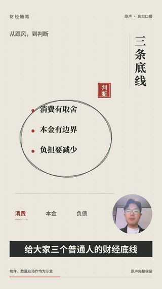
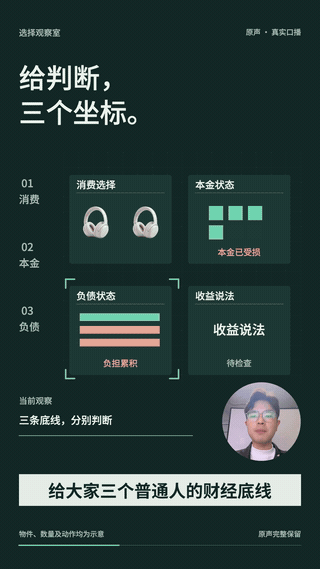
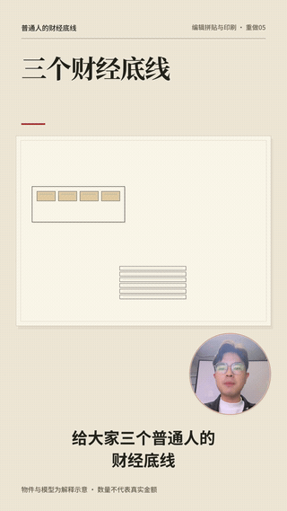
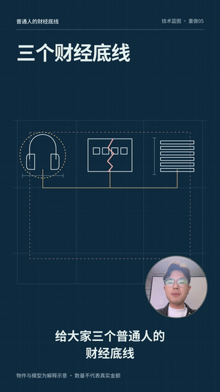
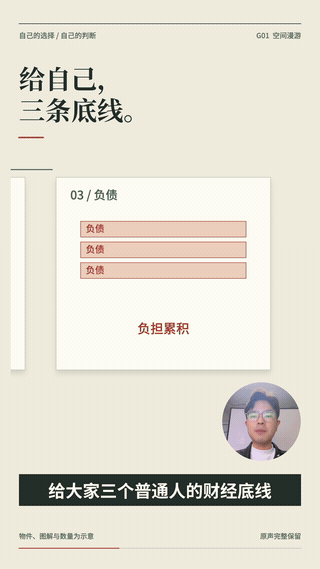
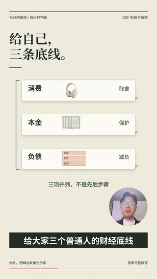
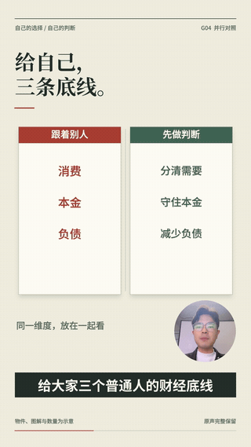

<div align="center">

# 网感口播

### 把你讲的内容，变成看得懂的画面。

把自己的真人口播交给智能体，让画风、排版、动作、镜头和转场围绕文案一起设计。

**19 套母画风配方 · 8 类编排 · 11 类专业协作 · 35 条当前案例**

[看效果](#看效果) · [直接这样说](#直接这样说) · [安装与准备](#安装与准备) · [画风与编排](#画风与编排) · [工作方式](#工作方式) · [使用指南](docs/常用指令与使用指南.md)

</div>

```text
使用网感口播插件，把我上传的口播做成完整视频。
根据文案自由选择画风和编排，让动作、图片和转场一起解释内容。
人物保持原色，角落用圆窗，字幕上移，保留原声。
```

你可以指定水墨、写实极简、技术蓝图等方向，也可以让智能体判断这段内容适合怎样讲。已有版本想再调整，直接说“只改字幕”“只改节奏”或“保留画风，换一种编排”。

“网感”是名字。视频可以克制、理性，也可以有手绘的轻松、印刷的层次或立体空间的变化，方向由你讲的内容决定。

## 看效果

下面 **9 组**使用**同一段 36.7 秒的自有真人口播**，均已有完整成片并获用户认可。动图统一截取各片的 **13–21 秒**，每组 8 秒、无声循环，可以比较同一句话在不同画风和编排中的呈现。

[自由搭配](#自由搭配同一句话三种表达) · [画风对比](#画风对比纸页工程线条与写实留白) · [编排对比](#编排对比同一画风三种讲述方式)

### 自由搭配：同一句话，三种表达

<table>
<tr>
<th width="33%">水墨写意 × 同物接力</th>
<th width="33%">精密界面 × 追踪与锁定</th>
<th width="33%">柔质立体 × 动作与后果</th>
</tr>
<tr>
<td></td>
<td></td>
<td></td>
</tr>
<tr>
<td>朱印和墨圈沿着讲述接力，上一段留下的判断进入下一段。</td>
<td>在稳定的工作台上检查、排除、锁定，焦点变化对应口播重点。</td>
<td>用落物、承压、拦截和卸载，把“选择带来后果”做成可见动作。</td>
</tr>
</table>

这三组同时改变了构图、对象行为和前后交接。真人的颜色、原声和讲述内容保持一致，因此可以直接比较画面如何帮助解释。

制作这组三版，可以这样说：

```text
用我的口播，从19套母画风和8类编排里自由搭配三组明显不同的组合。
先按文案设计对象、动作和可见结果，再安排图片、镜头和转场。
三条都做成完整视频，放在同一个页面在线播放对比。
```

### 画风对比：纸页、工程线条与写实留白

三套已认可配方采用不同的画面组织方式。技术蓝图是精密界面的分支；写实极简把人物留在主要位置，解释物件在旁侧配合。

<table>
<tr>
<th width="33%">编辑拼贴与印刷</th>
<th width="33%">技术蓝图</th>
<th width="33%">写实极简</th>
</tr>
<tr>
<td></td>
<td></td>
<td></td>
</tr>
<tr>
<td>纸页承载图像，衬线大字带出观点，批注与划线留下取舍。</td>
<td>深蓝底、线描与导轨建立关系，让对象沿同一工程平面接续。</td>
<td>人物承担主要讲述，实物与少量标签在留白中配合重点。</td>
</tr>
</table>

### 编排对比：同一画风，三种讲述方式

下面都采用编辑拼贴与印刷，让变化集中在**信息组织、物体动作、镜头和转场**。看同一段“先分清，再下单”如何被带进局部、拆成部件，或放在两侧比较。

<table>
<tr>
<th width="33%">空间漫游</th>
<th width="33%">拆解与组装</th>
<th width="33%">并行对照</th>
</tr>
<tr>
<td></td>
<td></td>
<td></td>
</tr>
<tr>
<td>先看整张图，再进入消费区域；局部始终有全局位置。</td>
<td>把三条建议分成部件，展开当前一块，其他部分仍有去处。</td>
<td>左右保留共同尺度，让两种选择的差异同时可见。</td>
</tr>
</table>

本机完整案例总览包含 **19 条母画风、1 条技术蓝图分支、8 条编排、2 条人物/图解、3 条自由搭配、2 条单模块修改**。支持筛选、搜索、卡片内播放、静音同播和单路原声。[查看总览使用方法](docs/全部案例总览.md)

仓库展示的是轻量预览；完整 MP4 和自有源片保存在本地工程。新机器需绑定本地视频后才能播放完整案例。

## 它能帮你做什么

| 你的需求 | 制作方式 |
|---|---|
| 把一段真人口播做成完整视频 | 读懂原句与段落关系，设计人物、图像、图解、动作和连续转场 |
| 用指定画风制作 | 采用对应配方，协调配色、材质、字体、镜头与运动方式 |
| 不知道怎么选，交给智能体 | 根据文案选母画风与主编排，说明理由后制作 |
| 同一内容做几版比较 | 在排版、动作、镜头与转场上拉开差异，同页在线播放 |
| 保留画风，只换讲述方式 | 改为同物接力、并行对照、分层揭示等编排，重新设计交接 |
| 只改某一个模块 | 另存版本，保护未选模块，检查必要的关联影响 |
| 以后增加新方向 | 先研究配方、样帧与完整片，认可后加入相应分类 |

## 直接这样说

先上传你自己的口播，或给出本地文件路径。**整片入口是 `talking-head-video`，不需要逐个调用十一类技能。**

### 指定画风

```text
使用网感口播插件，把我上传的口播做成完整视频。
采用「编辑拼贴与印刷」，用纸页、批注和图像之间的关系解释文案。
人物保持原色，角落用圆窗，字幕上移，保留原声，提供在线播放。
```

### 让智能体自由搭配

```text
使用网感口播插件，根据我的口播主题、语气和信息结构，
自主选择母画风与编排，简要说明理由后直接制作。
每个关键动作都要对应一句话，并留下看得见的结果；前后段落要能接上。
人物原色、角落圆窗、字幕上移，使用我自己的素材与原声。
```

### 同时指定画风和编排

```text
使用「精密界面」母画风下的「技术蓝图」分支，搭配「分层揭示」。
根据这段口播安排先看见什么、再揭开什么，转折发生时再展示新的信息。
保留人物原色、角落圆窗、上移字幕和原声，做成完整视频。
```

### 只改一个模块

```text
基于当前工程，只改字体版式：标题更突出，图解标签更清楚，解决文字遮挡。
保持画风、动作、镜头、转场和原声，另存一个版本在线播放对比。
```

```text
基于当前工程，只调整视觉节奏：对比结果多停留一点，减少同时发生的动作。
保留原声语速、时长、内容和编排主线，输出前后对比。
```

新开对话修改旧片时，请同时提供**可编辑工程路径**；仅有最终 MP4 时，需要先确认可修改范围。更多配色、物体动效、镜头与转场指令见[完整使用指南](docs/常用指令与使用指南.md)。

## 安装与准备

当前仓库已**公开**，无需登录即可查看 README、9 组动图和源码。已在本机 Codex / macOS 环境验证；其他智能体与操作系统需要适配验证。

### 已安装插件

直接提供自己的口播并使用上面的指令。如果需要先看案例，可以说：

```text
打开网感口播插件的统一选择入口和全部视频案例总览。
如果预览服务没有启动，请启动它。
```

### 在新环境中使用

可以把下面这段交给智能体：

```text
请从 https://github.com/maomyu/wanggan-talking-head 获取网感口播插件。
阅读 README 和 AGENTS.md，检查当前环境的插件安装方式，
配置本仓库运行依赖并运行 doctor。装好后告诉我如何提供自己的口播开始制作。
```

<details>
<summary>手动获取源码与检查运行环境</summary>

需要已安装的 Node.js（`^22.15.0 || >=23.5.0`）、Python 3.11+、FFmpeg 和 FFprobe。具体锁定依赖见 [runtime/package.json](runtime/package.json) 与 [requirements.txt](runtime/requirements.txt)。

```sh
git clone https://github.com/maomyu/wanggan-talking-head.git
cd wanggan-talking-head
node scripts/studio.mjs setup
node scripts/studio.mjs doctor
```

`setup` 将固定依赖装入本仓库的 `runtime`，不会注册 Codex 插件，也不会安装缺失的系统工具。插件注册由当前智能体宿主的安装流程完成；需要保留完整仓库结构，技能会引用共同规范、配方和运行器。

已经配置本机 `personal` 插件市场的环境可使用：

```sh
codex plugin add wanggan-talking-head@personal --json
```

该命令依赖本机已有市场配置，不是公开市场的一键安装地址。

</details>

## 画风与编排

**母画风决定视觉语言，编排决定观众如何跟随讲述。** 分支继续细化视觉方向，组件提供可复用的载体或行为，四者分别管理。

例如：选“精密界面”作为母画风，选择其“技术蓝图”分支，再根据文案使用“分层揭示”；换成“并行对照”时，比较关系与动作要跟着重设计。

<details>
<summary><b>展开 19 套母画风配方</b></summary>

| 配方 | ID | 主要视觉语言 |
|---|---|---|
| 写实极简 | `minimal` | 真人与实物、克制留白、清楚比较 |
| 现代几何平面 | `geometry` | 块面、轴线、明确的图底关系 |
| 编辑拼贴与印刷 | `editorial-print` | 页栏、裁切、纸页与批注 |
| 拼贴混合媒介 | `collage` | 异质图像、接缝、叠压关系 |
| 单线手绘 | `line` | 描线、纸白、关系接续 |
| 平面插画 | `illustration` | 具象物件、色面、可读情境 |
| 精密界面 | `precision` | 功能分区、标注、状态反馈 |
| 复古网点 | `halftone` | 有限油墨、网点、分区对照 |
| 漫画描线 | `comic` | 分格、描边、视线顺序 |
| 水墨写意 | `ink` | 墨阶、虚实、大留白 |
| 柔质立体 | `clay` | 体量、接触、投影与空间 |
| 像素复古 | `pixel` | 离散网格、受限显示 |
| 剪纸舞台 | `papercut` | 片层、切口、厚边与舞台 |
| 工笔设色 | `gongbi` | 细线立骨、多层淡色 |
| 青绿山水 | `landscape` | 前后景、矿物色层、游观空间 |
| 壁画重彩 | `mural` | 重彩画带、壁面、叙事分区 |
| 水彩洇染 | `watercolor` | 透明洗色、湿边、纸白 |
| 厚涂油画 | `oil` | 笔触、覆盖、体块与侧光 |
| 木刻版画 | `woodcut` | 正负形、刻线、版边 |

技术蓝图 `blueprint` 是精密界面的分支。各配方的完整规则见[19套配方与统一入口](docs/19套配方与统一入口.md)。历史 100 项已归入母画风、分支和组件，保留有效实现，不再作为日常选项重复展示。

</details>

### 8 类编排，各自解决一个讲述问题

| 编排 | 适合怎样的内容 | 画面怎样推进 |
|---|---|---|
| 空间漫游 | 整体与局部、空间或步骤 | 在同一总图中移动、进入局部，再回到整体 |
| 同物接力 | 同一对象贯穿多段 | 对象交接任务，保持身份和已经发生的变化 |
| 拆解与组装 | 组成、结构、部件关系 | 拆开看清各部分，再呈现组合后的关系 |
| 并行对照 | 两种选择、前后差异 | 保持共同尺度，让差别同屏可读 |
| 分层揭示 | 表象、条件、转折 | 按讲述顺序揭开新信息，留下理解时间 |
| 动作与后果 | 原句明确支持的因果 | 条件触发动作，结果真实留在画面中 |
| 追踪与锁定 | 检查、筛选、判断 | 从范围到依据，再锁定或排除目标 |
| 人物现场回应 | 观点、经历、情绪 | 由真人先讲，图片、文字与批注接话 |

人物主导、连续图解仍可作为兼容的注意力安排。智能体先选适合内容的主编排，再按需要使用局部技巧。[查看完整编排规则](docs/八类编排机制.md)

## 工作方式

### 先找到文案里的动作

一句“分清想要和需要”，可以让额外加购的物件被筛走、日常所需被留下；一句“减少负担”，可以让承重台在物件卸下后回升。动作需要呈现这句话带来的变化。

每段先写清：

```text
原句与关系 → 对象初态 → 动作 → 可见结果 → 读图停留 → 下一段接住什么
```

图片承担对象身份、证据、空间参照或状态变化中的具体任务。前一段留下的对象与结果，成为后一段继续解释的基础。换素材时重新读文案、设计对象与交接。[新素材制作流程](docs/新素材制作流程.md)

### 11 类技能共用一条时间线

| 专业技能 | 负责什么 |
|---|---|
| [主画风](skills/talking-head-art-style/SKILL.md) | 确定整体视觉语言与形式边界 |
| [配色](skills/talking-head-palette/SKILL.md) | 给背景、文字和语义对象分配颜色角色 |
| [材质外观](skills/talking-head-material/SKILL.md) | 纸、墨、网点、软体等表面如何呈现 |
| [造型呈现](skills/talking-head-representation/SKILL.md) | 对象以什么形态存在，身份如何保持 |
| [物体动效](skills/talking-head-object-motion/SKILL.md) | 动作如何产生可见结果 |
| [镜头](skills/talking-head-camera/SKILL.md) | 观察距离、取景与视线如何变化 |
| [转场](skills/talking-head-transition/SKILL.md) | 前一状态如何交接给后一状态 |
| [字体版式](skills/talking-head-typography/SKILL.md) | 人物、标题、字幕、图片和图解的主次 |
| [光影质感](skills/talking-head-lighting/SKILL.md) | 明暗、投影、颗粒与整体收束 |
| [信息组织](skills/talking-head-information/SKILL.md) | 因果、对比、转折与并列如何被解释 |
| [节奏](skills/talking-head-rhythm/SKILL.md) | 重音、动作密度、阅读停留与段落松紧 |

由[整片入口](skills/talking-head-video/SKILL.md)与[协作统筹](skills/talking-head-composition/SKILL.md)协调。原有[画风](skills/talking-head-art-direction/SKILL.md)、[排版](skills/talking-head-layout/SKILL.md)、[动效](skills/talking-head-motion/SKILL.md)、[剪辑转场](skills/talking-head-editing/SKILL.md)四份完整专家方法继续保留。

### 这些制作原则始终保留

- **人物保持原色。** 画风作用于背景、文字、图解和载体；保留真人的肤色、服装和身份。
- **角落使用圆窗。** 缩放和移动过程中也保持正圆，检查头部裁切与遮挡。
- **字幕适当上移。** 给字幕留阅读区，按画幅和实际字数检查，不压在画面底部。
- **默认用自己的口播与原声。** 尊重原意，声音与画面共用时间依据；未指定声音任务时保留原声。
- **修改保留旧版。** 局部修改保护未选模块，必要关联调整说明原因与范围。
- **交付后清理制作残留。** 保留源素材、工程、最终片与关键证据，清理可重建缓存。

### 拿到的是可播放的成片与可继续修改的工程

整片制作完成后交付实际 MP4、本地在线播放页、工程源码与素材引用、配方和时间计划，以及检查记录。统一页面还提供可复制指令，方便下一次继续制作或单独修改。

新视频会经历设计、构建、渲染和检查。制作时查看实际画面与运动过程，检查字幕遮挡、人物窗口、图像任务和段落衔接；交付时核验编码、时长、声音及在线播放。具体完成情况以本片检查记录为准。

## 常用命令

日常直接说需求即可。以下供维护者或希望自己检查工程的人使用，在插件根目录执行：

| 命令 | 用途 |
|---|---|
| `node scripts/studio.mjs doctor` | 检查运行依赖与插件完整性 |
| `node scripts/studio.mjs catalog` | 查看母画风、分支、组件与配方 |
| `node scripts/studio.mjs orchestrations` | 查看编排规则 |
| `node scripts/studio.mjs combinations` | 查看已认可组合 |
| `node scripts/studio.mjs inspect --recipe ink` | 查看水墨配方 |
| `node scripts/studio.mjs help` | 查看完整命令 |

<details>
<summary>新建工程、单模块修改与本地预览</summary>

下面的路径是占位示例，请替换为实际路径。工程放在插件目录外。

```sh
# 新素材：初始化后，由智能体完成本片设计与实现
node scripts/studio.mjs init --project /path/to/new-film --source /path/to/my-video.mp4 --recipe ink --orchestration relay

# 已有工程：只改字体版式，另存版本
node scripts/studio.mjs revise --from /path/to/film --out /path/to/film-v2 --axes typography --request "只优化标题与字幕"

# 本片设计和实现就绪后，构建、检查、渲染、核验
node scripts/studio.mjs run --project /path/to/film-v2 --until verify

# 打开该工程的本地在线播放服务
node scripts/studio.mjs preview --project /path/to/film-v2

# 生成独立配方选择页，再启动预览
node scripts/studio.mjs catalog-ui --project /path/to/selector
node scripts/studio.mjs preview --project /path/to/selector
```

`init` 建立待设计工程；`reproduce` 只用于明确复现绑定源片的案例。无媒体绑定的选择页展示配方与参考图，完整案例需按[总览说明](docs/全部案例总览.md)绑定本地成片。

</details>

## 当前验证到哪里

19 套母画风、技术蓝图分支、8 类编排和三组自由搭配均有同源完整案例；配色与节奏已有单模块完整视频实测。**19 × 8 的选择空间不等于 152 种组合全部验收。**

新的自有口播需要重新设计动作、图片和转场；跨文案实测仍等待新的自有素材。制作耗时与结果取决于素材长度、内容复杂度、智能体能力和修改要求。插件提供专业方法与运行工具，由智能体完成具体设计。

项目公开可查看与获取，尚未声明开源许可证。依赖、字体等第三方资源按各自许可使用。完整片与原素材默认留在本地，不随源码同步。

## 文档与仓库结构

| 想了解什么 | 从这里开始 |
|---|---|
| 日常怎么调用 | [常用指令与使用指南](docs/常用指令与使用指南.md) |
| 母画风、分支、组件怎么选 | [19套配方与统一入口](docs/19套配方与统一入口.md) · [分类与配方](docs/分类与配方.md) |
| 智能体如何自由搭配 | [自由搭配流程](docs/智能体自由搭配流程.md) |
| 多模块如何交接 | [协作合同](docs/协作合同.md) · [共同制作规范](docs/共同制作规范.md) |
| 完整视频在哪里看 | [全部案例总览](docs/全部案例总览.md) |
| 版本记录与验收 | [文档目录](docs/) · [本次 README 更新](docs/1.23.5验收.md) |

```text
skills/       整片入口、协作统筹与专业技能
registry/     母画风、分支、组件、编排及认可组合
recipes/      完整生产配方
examples/     可复用实现与源特定案例
runtime/      固定运行依赖与制作工具
scripts/      统一命令、校验与维护入口
assets/       字体、选择页与共享资源
evidence/     已有案例的认可与检查记录
docs/         使用指南、制作方法与版本记录
```
