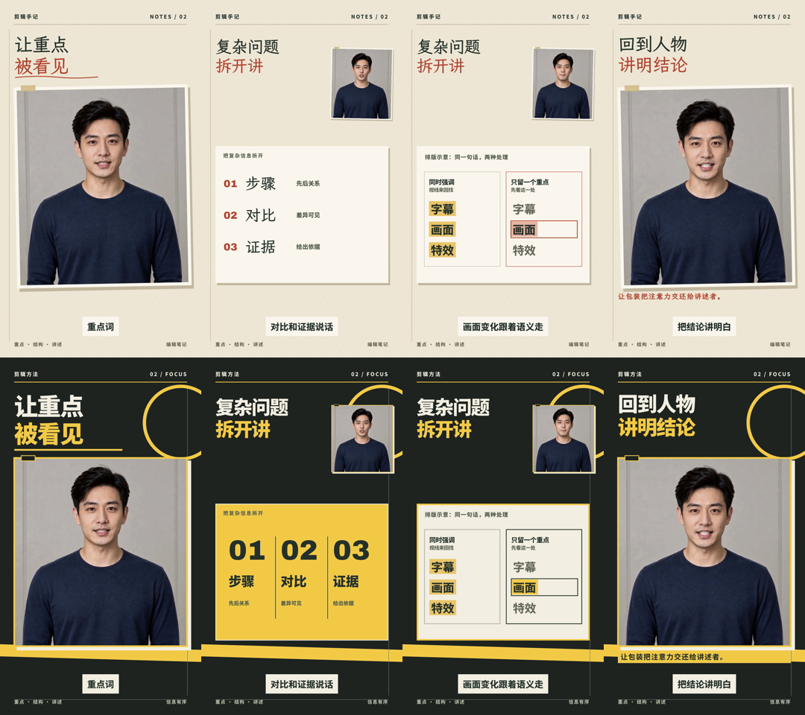

# 已认可的画风示例

2026-10-18，用户看过本地样片后表示喜欢当前画风。以下保留本次纸本批注、几何印刷两个方向的可执行关系，供后续任务参考；用户的认可针对这一轮画风，不扩展为所有人物、所有题材的验证结论。

共同素材条件：同一个既有虚构数字人，连续14秒中文口播，1080×1920、24fps；同一字幕时间和人声。图解为原创解释示意，没有真实资料长文。声音变量保持一致，没有加入音乐或音效。

## 纸本批注

观看体验：跟讲述者一起阅读被标记的剪辑笔记。

- 主画面以暖纸、深墨、朱红批注建立阅读层次。本例色值分别为#eee6d6、#28332e、#b74732，局部阅读表面采用偏白纸色。
- 文楷承担标题和批注气质，黑体承担字幕与说明。新内容使用前检查实际字形覆盖和所需字重。
- 人物保留原肤色及摄影光线，通过纸框、纸边和轻微倾斜与背景关联。纤维只作用于背景。
- 大幅人物先建立讲述，解释时人物让出主区域；步骤纵向排列，比较图单独展开，结尾回到人物。
- 描线、轻落、逐步显现共同形成动作语言；阅读时保持稳定。

## 几何印刷

观看体验：通过大字、直边块面和分区，直接呈现一句话的结构。

- 深炭#222622、暖白#f5f0e4、印刷黄#f4ca49建立对比；阅读表面切为黄底或白底时，文字改用深色。
- 重黑体承担标题、关键词和说明，粗体数字承担步骤序号。本例使用思源黑体与Archivo Black。
- 以平涂、硬边框、几何形和错位底版形成印刷感，人物保留摄影特征。
- 人物和大字建立开头；解释时采用横向三段结构，比较图继续同一色光和边框关系；最后人物回归主层。
- 轴向滑入、块面落定与语义触发的强调共同组成运动，停稳时间服务阅读。

## 可复用的协作依据

| 模块 | 共用规则 | 由模块落实 |
| --- | --- | --- |
| 排版 | 字体气质、阅读表面与层级、代表画面 | 实际断句、字号、位置和阅读顺序 |
| 动效 | 材料行为、运动强弱、重要状态 | 路径、缓动、错峰与时间 |
| 剪辑 | 人物和解释画面的关系 | 语义切点、素材位置、镜头时长 |
| 声音 | 整片情绪和留白方向 | 具体音乐、音效与混音；本例未覆盖 |

本次修正说明：背景变化必须同时检查字色；焦点移动必须同步框线、底色和字色；更换字体要重新检查线条与字面的关系。不能仅凭统一的色板就判断协调。

后续应用可改变人物位置、切换顺序、画幅、镜头时长与颜色。图中的固定构图、14秒长度和具体色值是本次示例，不是新任务必须遵守的模板。保留足以识别方向的关系，并按真实内容重新组织。
