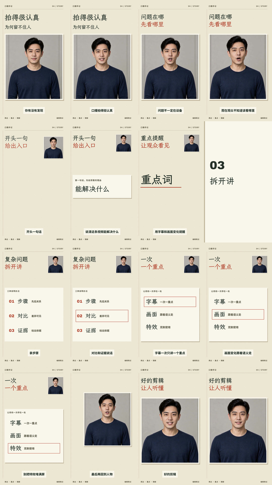

# 本次完整口播案例

研究位置：`test/四模块串联研究_20261018/full-study-01`。最终结果与证据见研究根目录的 `串联实测结论.md`，不将当前案例的坐标、句数或时间当成未来内容模板。

## 选择

只制作一条纸本批注风格完整口播，沿用已认可的虚构数字人原片和原声，不新增生成素材、音乐或音效。人物保留真实媒介，与纸面、红色批线和手写标题协作。

保留21句完整口播和原有顺序，包括开头问题、“不一定”的条件、“别堆特效”的否定和完整结论。原片724帧，剪掉8帧停顿和18帧尾部留白，最终698帧/29.0833秒，1080×1920、24fps。

## 四模块实际产物

- 画风：`plans/art-direction.json` 给出字体、色彩、材料和人物处理；构建器将其用于实际CSS与转场。
- 剪辑粗剪：`plans/edit-plan.json` 决定8个源区间；合并为2段连续人声，唯一实际源断点在输出353帧。
- 排版：`plans/layout-plan.json` 给出首帧、人物页边窗口、关键词、并列图解、逐行强调与结尾的主次及几何；统一保护字幕区。
- 动效：`plans/motion-plan.json` 采用源语义与shot锚点，映射后驱动同一人物容器、笔线、重点框与纸页。
- 统筹：`scripts/build-study.mjs` 消费四份产物，生成一份 `timing.json`、HTML、字幕映射与 `run-record.json`。

这些方案由当前代理依据完整skill形成；不是程序读取几篇Markdown就自动完成设计。构建器仅是本案例的可重复执行入口，保留模块判断空间。

## 联动验证

隔离探针恢复D段前1帧停顿。后续11句字幕、6个检查的语义动作与总帧数同步增加1帧，音频每声道增加2000采样；遮挡仍围绕实际切点。最终HTML哈希保持不变。证明的只是接口联动，实际像素、声音与审美另行检查。

## 改进

“别把特效堆满屏”采用完整否定句起点强调，替代晚于句头约0.5秒的词级候选；重点框停稳后可保持17帧，再收起解释。文字已从前一状态完整在场，不将全部阅读时间只算成这17帧。

## 证据与限制

- 完整skill快照与模块方案以 `module-manifest.json`、`run-record.json` 哈希绑定。
- `qa/integration-check.json` 是联动探针；`qa/check-final.json` 是指定状态的布局、运行和对比检查；motion自动审计未启用，不冒称全量动效通过。
- `qa/encoded-verification.json` 绑定实际成片，记录编码规格、原声参考对齐、源帧样本、遮挡检测和抽帧范围。
- 预览页验证实际入口相对资源、Range响应、完整播放与跳转。
- 作者视觉自查，无独立盲评；程序对齐不能替代人耳判断语气和韵律。用户已将跨内容验证留到真实使用，不新增前置条件。

